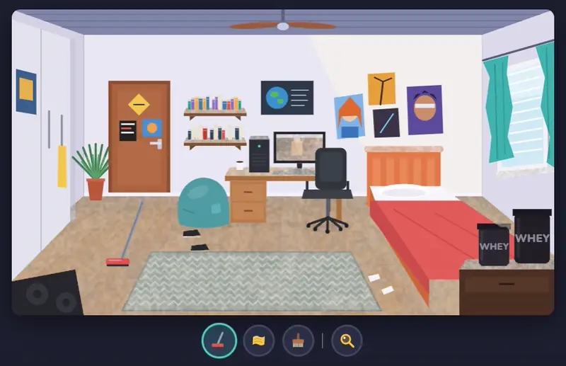

  

  Это прототип игры <b>Dust Cleaner Simulator</b>, уютной игры про уборку пыли. Пылесос, тряпка и щётка: у каждого инструмента своя поверхность.

  <a href="https://complewin.github.io/dust-cleaning-sim-prototype/"><b>🎮 Играть</b></a>

---

### Управление

| Действие | Мышь / палец | Клавиатура |
|---|---|---|
| Убирать | зажать и водить | — |
| Инструмент | иконки снизу | `1` `2` `3` |
| Подсветить оставшуюся пыль | лупа | `Q` |
